Projeto de portfólio de DBA com PostgreSQL 18, focado em modelagem, performance, segurança, backup/restore e monitoramento.
DBA portfolio project using PostgreSQL 18, focused on modeling, performance, security, backup/restore, and monitoring.

1. Modelagem (Modeling)
Banco de dados library para gestão de biblioteca.

Tabelas:
authors(author_id, name)
books(book_id, title, author_id, is_available)
members(member_id, name, email)
loans(loan_id, book_id, member_id, loan_date, return_date)

Relacionamentos:
authors  1 ─── N books
books    1 ─── N loans
members  1 ─── N loans

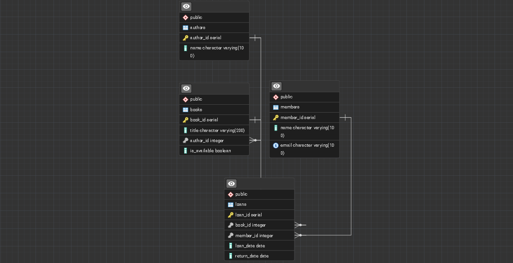
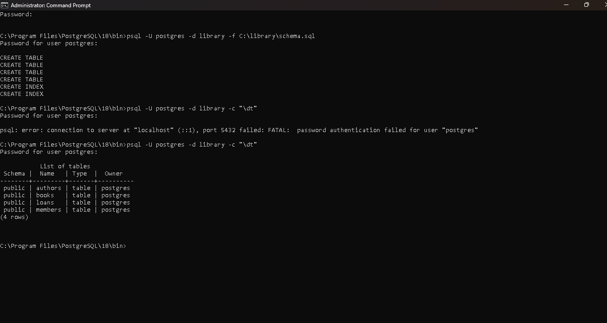
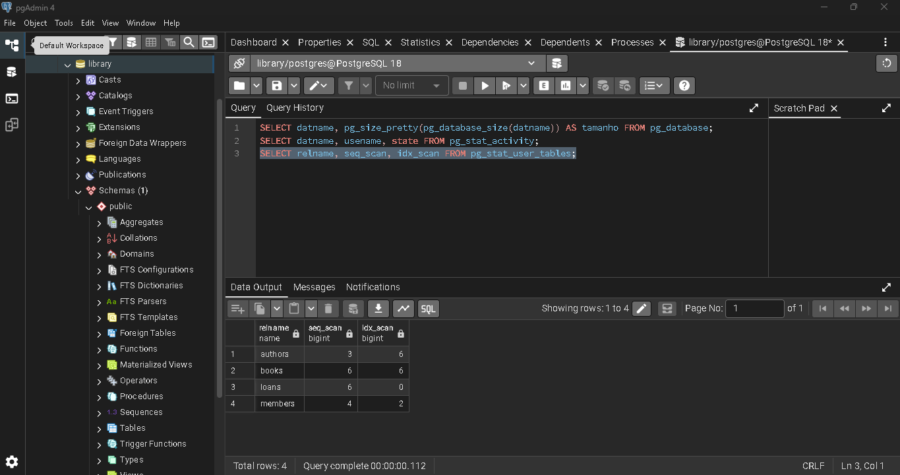

2. Performance (Indexes)
Criados para otimizar as consultas mais frequentes:

CREATE INDEX idx_books_author ON books(author_id);
CREATE INDEX idx_loans_member ON loans(member_id);

3. Segurança (Roles)
Arquivo: roles.sql
Usuários criados: librarian (escrita) e read (somente leitura)

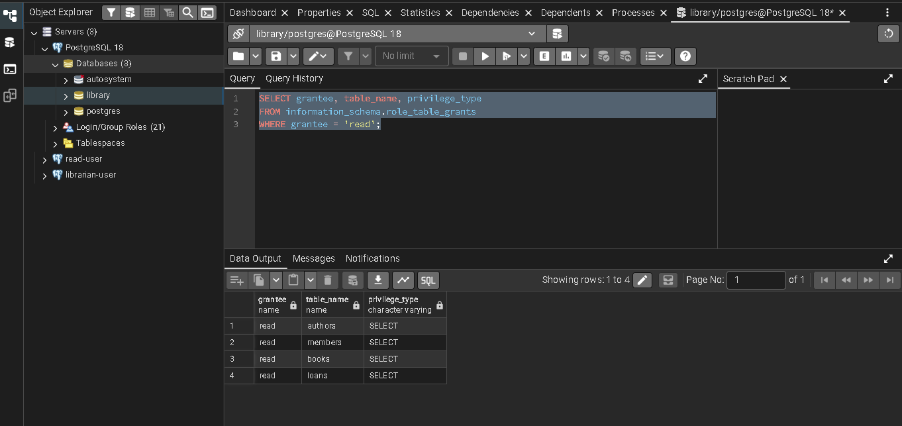
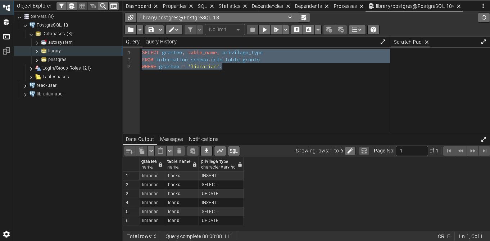
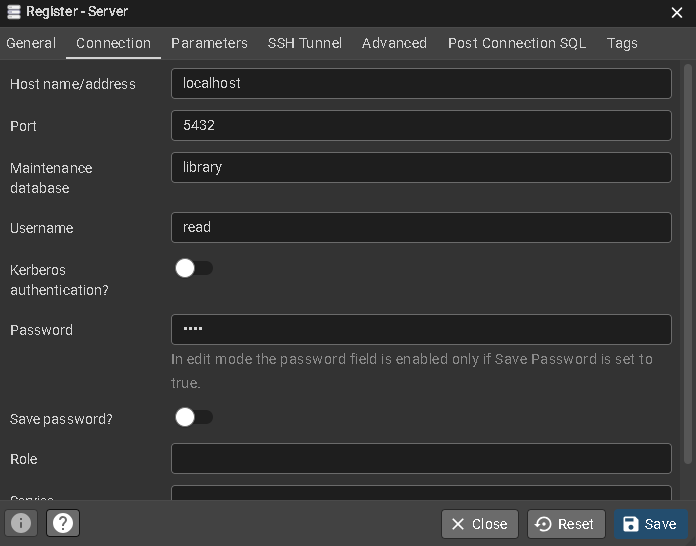
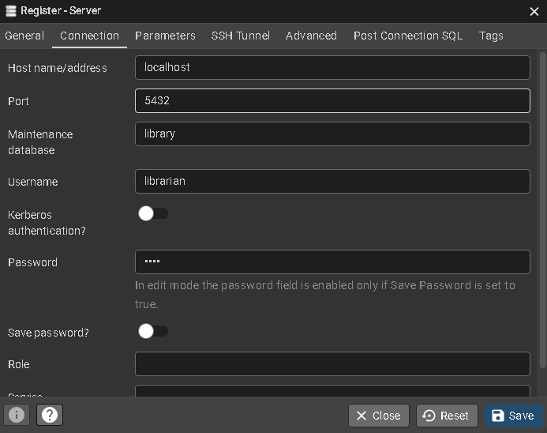

4. Backup/Restore
Arquivo: library_backup.dump

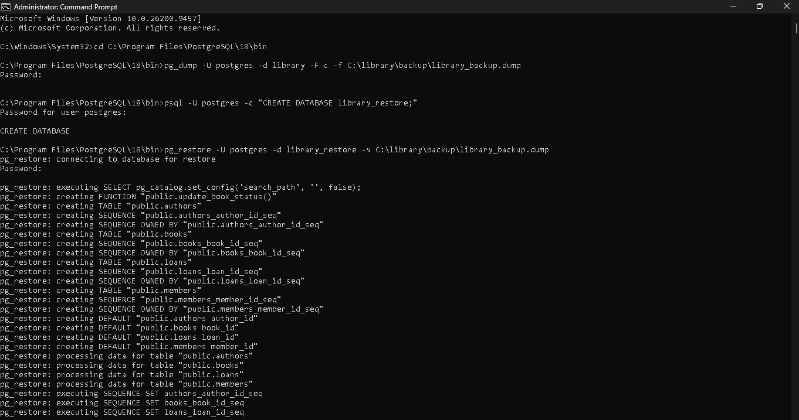
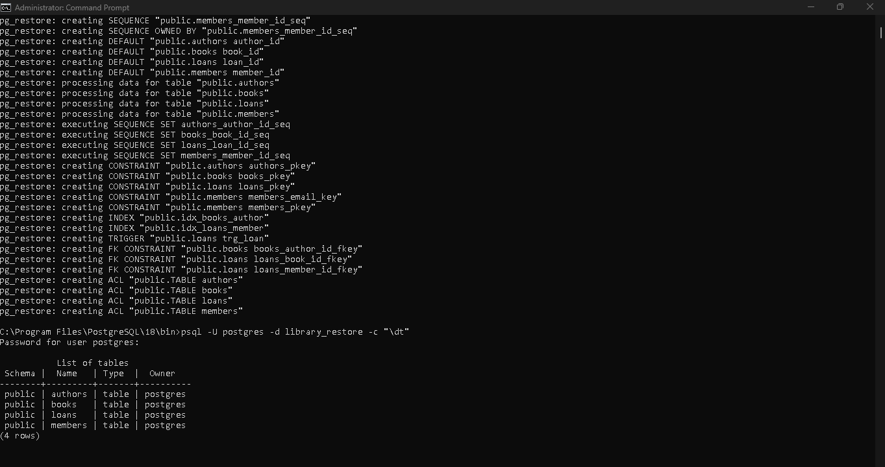

O restore recriou tabelas, dados, constraints e índices com sucesso.
pg_dump -U postgres -d library -F c -f C:\library\backup\library_backup.dump
pg_restore -U postgres -d library_restore -v C:\library\backup\library_backup.dump

5. Monitoramento
Arquivo: monitoring.sql

SELECT datname, pg_size_pretty(pg_database_size(datname)) AS tamanho FROM pg_database;
-- library com 8286 kB

SELECT datname, usename, state FROM pg_stat_activity;
-- Mostra conexões ativas

SELECT relname, seq_scan, idx_scan FROM pg_stat_user_tables;
-- Tabelas mais acessadas

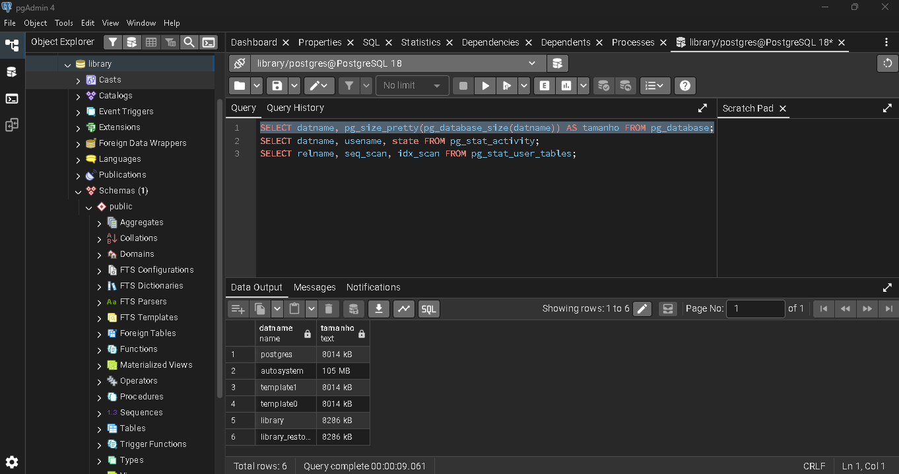

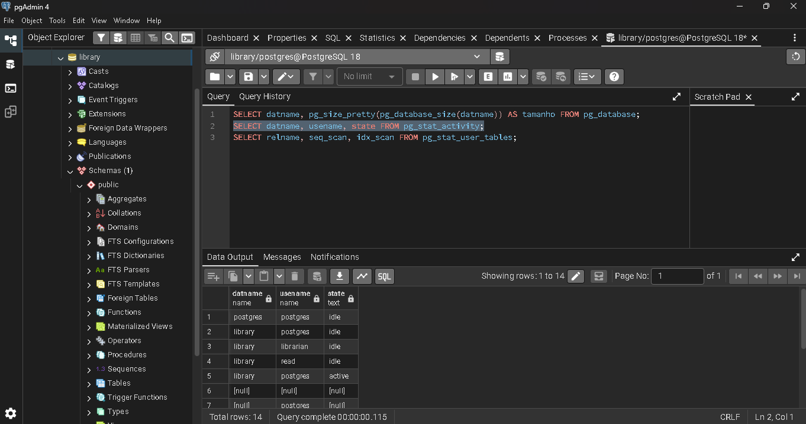

Como executar:
psql -U postgres -d library -f schema.sql
psql -U postgres -d library -f data.sql
psql -U postgres -d library -f roles.sql
psql -U postgres -d library -f monitoring.sql

Stack: PostgreSQL 18, pgAdmin 4, pg_dump / pg_restore